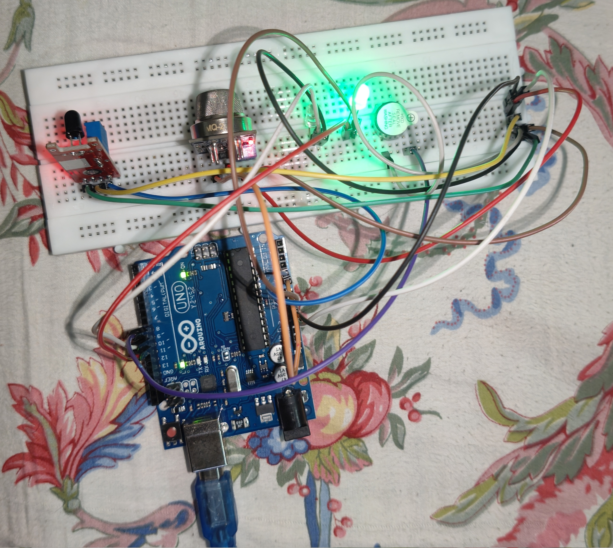
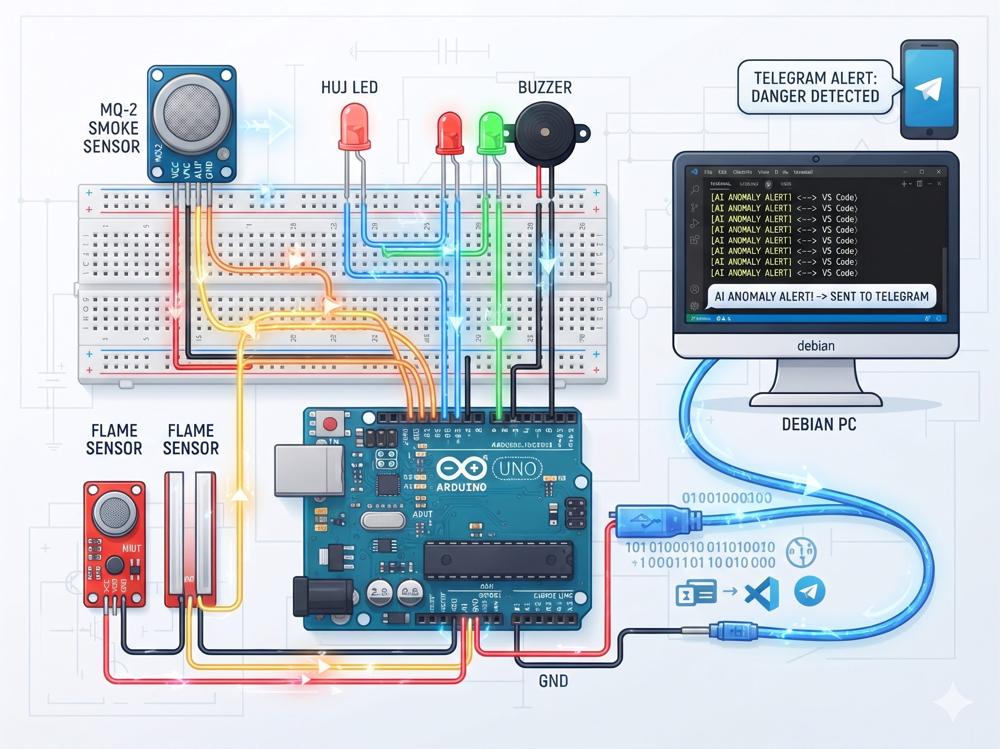

# 🤖🔥 AI-Powered Smoke & Fire Detection Alarm

An intelligent, IoT-based safety alarm system powered by an **Arduino Uno**, an unsupervised **Machine Learning model (Isolation Forest)** running in Python on Debian, and real-time **Telegram mobile push notifications**.

---

## 📸 Hardware Setup & Schema

<div align="center">
  
  
  <p><em>Complete circuit assembly featuring Arduino Uno, MQ-2 Smoke Sensor, Flame Sensor, and Buzzer.</em></p>
</div>

---

## 🛠️ Components Used
* **Arduino Uno** (Microcontroller)
* **MQ-2 Gas & Smoke Sensor** (Blue PCB)
* **Flame Sensor** (Red PCB)
* **Piezo Buzzer** (Audio Alarm)
* **Red & Green LEDs** (Visual Status Indicators)
* **Breadboard & Jumper Wires**
* **Debian PC / Linux Workstation** running Python & VS Code

---

## 🔌 Connection Schema & Wiring

| Component | Component Pin | Connected To (Arduino / Breadboard) |
| :--- | :--- | :--- |
| **Power Rails** | Arduino `5V` <br> Arduino `GND` | Breadboard **+ (Red)** Rail <br> Breadboard **- (Blue)** Rail |
| **MQ-2 Smoke Sensor** | VCC <br> GND <br> AOUT | Breadboard `+` Rail <br> Breadboard `-` Rail <br> Arduino Pin **A0** |
| **Flame Sensor** | VCC <br> GND <br> AOUT | Breadboard `+` Rail <br> Breadboard `-` Rail <br> Arduino Pin **A1** |
| **Piezo Buzzer** | Positive (`+`) <br> Negative (`-`) | Arduino Digital Pin **8** <br> Breadboard `-` Rail |
| **Red LED** | Anode (`+`) <br> Cathode (`-`) | Arduino Digital Pin **9** <br> Breadboard `-` Rail |
| **Green LED** | Anode (`+`) <br> Cathode (`-`) | Arduino Digital Pin **10** <br> Breadboard `-` Rail |

---

## 🚀 Getting Started & Installation

### 1. Arduino Firmware
1. Open the **Arduino IDE**.
2. Select your board (`Arduino Uno`) and correct port (`/dev/ttyACM0`).
3. Upload the combined sensor code (`arduino_code.ino`) to your Arduino Uno.

### 2. Python Environment Setup (Debian / Linux)
Open your terminal in the project directory and run:

```bash
# Create and activate virtual environment
python3 -m venv venv
source venv/bin/activate

# Install required dependencies
pip install pyserial scikit-learn numpy requests